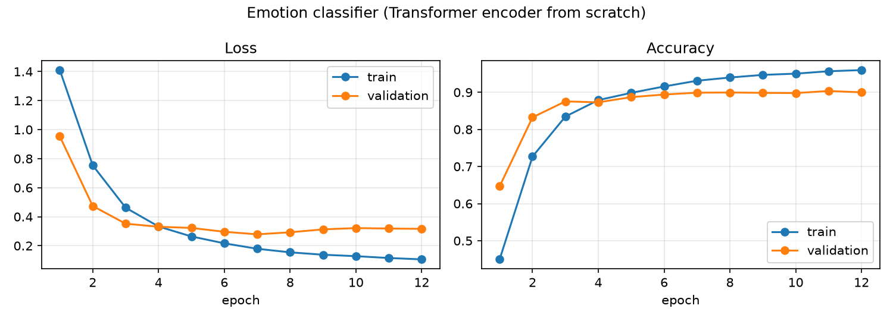
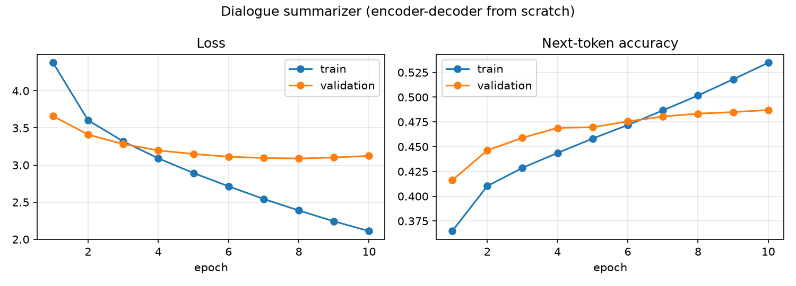

# Transformers from Scratch

Transformer models implemented from the ground up in **PyTorch**: multi-head attention, masking, encoder and decoder blocks, and greedy decoding. They are trained end-to-end on two NLP tasks and compared with fine-tuning a pretrained **T5** using Hugging Face.

| Task | Model | Data | Result |
|---|---|---|---|
| Emotion classification (6 classes) | Encoder-only Transformer, **from scratch** (9.4M params) | dair-ai/emotion | **88.5% accuracy**, 84.4 macro-F1 |
| Dialogue summarization | Encoder-decoder Transformer, **from scratch** (42M params) | DialogSum | **35.4 ROUGE-1**, 29.1 ROUGE-L |
| English → French translation | **T5-small fine-tuning** (60M params) | Europarl (100k pairs) | BLEU 37.5 → **38.3** |

All results come from a 4 GB laptop GPU (RTX 500 Ada).

## What's inside

- `MultiHeadAttention` for self- and cross-attention, with padding and **causal masking**
- `LayerNorm`, position-wise `FeedForward` and learned positional embeddings, all written by hand
- `EncoderBlock` / `DecoderBlock` with residual connections and **post-norm or pre-norm**
- `TransformerClassifier`, which classifies from the `[CLS]` token
- `Seq2SeqTransformer` with **teacher forcing** for training and batched **greedy decoding** for generation
- Training scripts with dynamic padding, gradient clipping, checkpointing on the best validation loss, and ROUGE / BLEU evaluation
- Unit tests that check attention masking, padding invariance and that **the decoder cannot see future tokens**

## Results

### Emotion classification



Ablation on the test set (same data, 12 epochs):

| Setup | Accuracy |
|---|---:|
| lr 1e-3, no padding mask | 71.8% |
| lr 3e-4, no padding mask | 86.8% |
| + padding mask | 87.5% |
| + 2 layers, pre-norm | **88.5%** |

The learning rate matters most. At 1e-3 (no warmup, post-norm), the first epoch barely beats predicting the majority class (39% validation accuracy). Training then converges slower and to a worse solution.

```
joy       100%  I feel so happy and grateful today
fear      100%  I am terrified of what might happen tomorrow
sadness   100%  I miss you so much, I feel lonely without you
anger      96%  I can't believe they lied to me again, I'm furious
surprise   99%  I was shocked when I saw the results
```

### Dialogue summarization



A 2-layer encoder-decoder trained from random weights on 12.5k dialogues. Validation loss bottoms out at epoch 8, and that checkpoint is kept. The summaries follow the DialogSum style and usually find the topic, but they still miss details. Fine-tuned pretrained models such as BART score in the mid-40s ROUGE-1 on this dataset: pretraining is what closes the gap.

```
REFERENCE : #Person2# arrives late because of traffic jam. #Person1# persuades #Person2#
            to use public transportations to keep healthy and to protect the environment.
GENERATED : #Person2# tells #Person1# that #Person2#'s driving test and #Person2#'s worried
            about the car and #Person2#'s car is a car. #Person2# will take a car.
```

### Translation (T5 fine-tuning)

T5-small fine-tuned for one epoch on 100k Europarl sentence pairs (lr 3e-4), evaluated on 1,000 held-out pairs with beam search:

| | BLEU |
|---|---:|
| T5-small, off the shelf | 37.5 |
| after fine-tuning | **38.3** |

The gain is small because T5's pretraining mixture already includes WMT English-French, which itself contains Europarl. The difference shows up in phrasing:

```
EN     : It's not so much that the plan failed as that it was never really tested.
before : Ce n'est pas tant que le plan a échoué que qu'il n'a jamais été vraiment mis à l'essai.
after  : Ce n'est pas tant que le plan a échoué qu'il n'a jamais été vraiment testé.
```

Idioms are still a weak spot: *"kicked the bucket"* is translated word for word.

## Quick start

```bash
git clone https://github.com/Ykuzaa/transformers-from-scratch.git
cd transformers-from-scratch
uv sync --all-extras          # or: pip install -e ".[train]"

uv run pytest                                  # unit tests (CPU, seconds)
uv run python scripts/train_classifier.py      # ~2 min on a laptop GPU
uv run python scripts/train_summarizer.py --epochs 10
uv run python scripts/finetune_t5.py
uv run python scripts/demo_pipelines.py        # pretrained pipelines: sentiment, chat, sampling
```

Each script takes `--help`. Metrics, training curves and the best checkpoint are written to `results/`.

```python
import torch
from minitransformer import Seq2SeqTransformer

model = Seq2SeqTransformer(vocab_size=50265, src_max_length=512, tgt_max_length=64, num_layers=2)
src = torch.randint(0, 50265, (2, 100))
summary_ids = model.generate(src, torch.ones_like(src), bos_id=0, eos_id=2)
```

## Project layout

```
src/minitransformer/
├── layers.py     # attention, LayerNorm, feed-forward, embeddings
├── blocks.py     # encoder / decoder blocks, causal and padding masks
├── models.py     # classifier, encoder-decoder, greedy generation
└── training.py   # seeding, device, plots
scripts/          # training and demo entry points
tests/            # pytest suite
```

## Tech stack

Python · PyTorch · Hugging Face Transformers, Datasets and Evaluate · scikit-learn · CUDA · uv · pytest · ruff

**Keywords:** Transformer architecture, self-attention, cross-attention, causal masking, encoder-decoder, sequence-to-sequence, NLP, text classification, abstractive summarization, machine translation, fine-tuning, transfer learning, ROUGE, BLEU, deep learning.

## License

MIT
